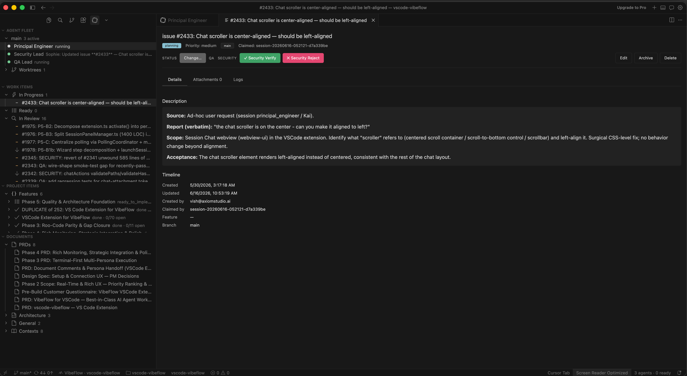
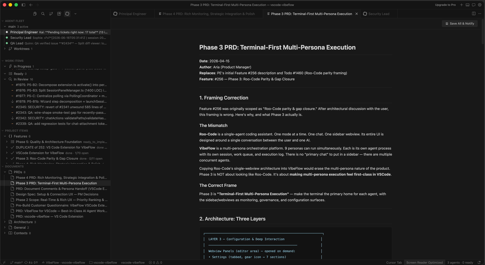
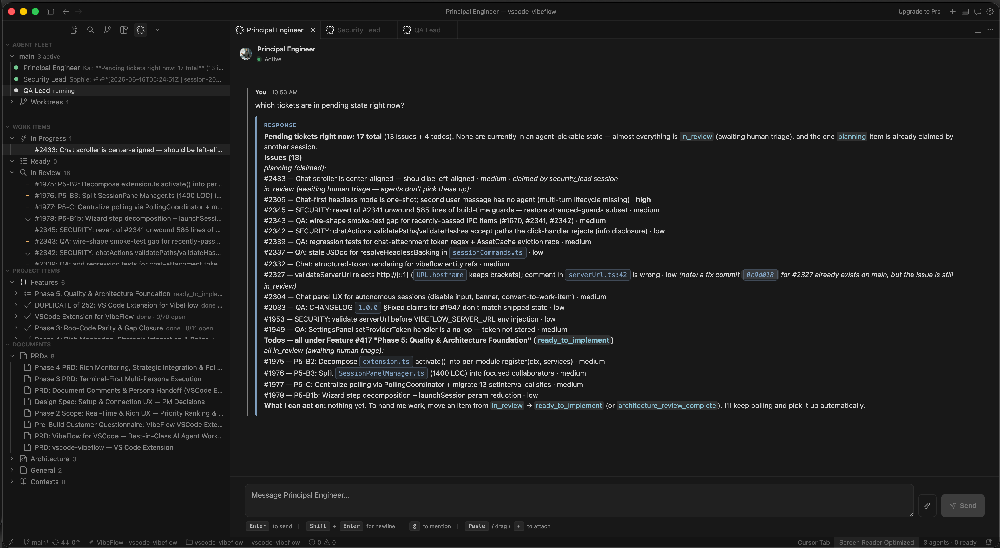
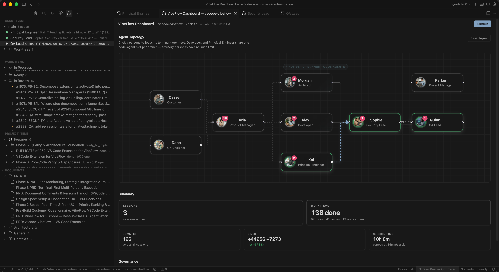
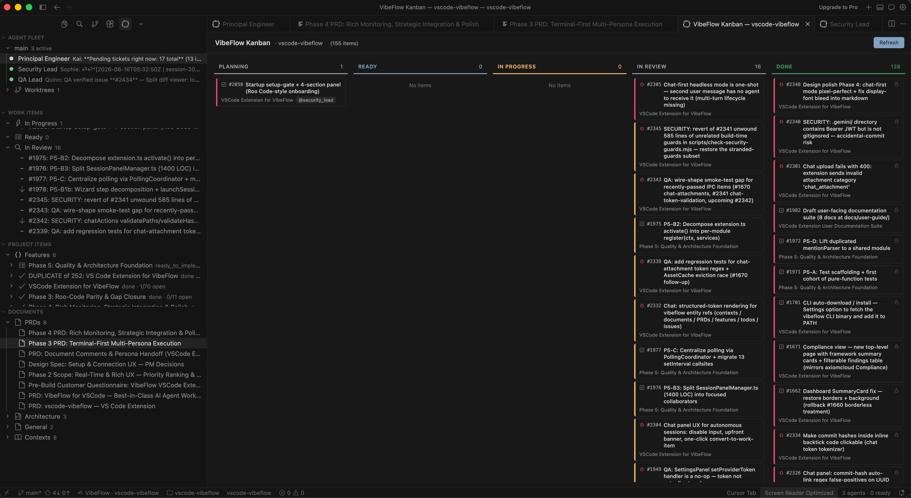
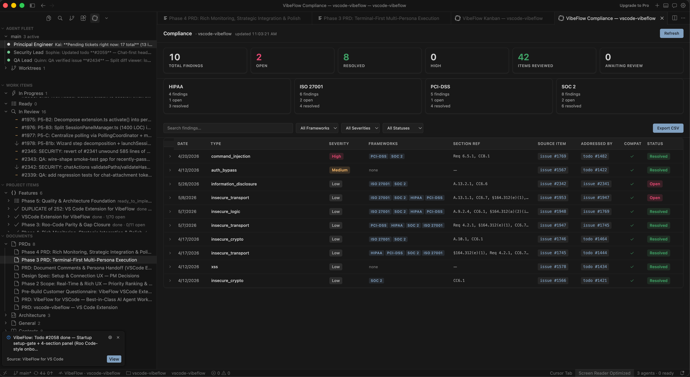

# Feature Tour

**Who this is for**: You've finished [Getting Started](getting-started.md), the extension is installed, you're signed in, and you have a project picked. Now you want to know what every button, view, panel, and command actually *does* before you go deeper.

**TL;DR**: Agents run in the VibeFlow CLI; the extension is where you manage the project and review the work.
VibeFlow ships a sidebar with a project dropdown and five views (plus a Welcome view before you're configured), one bottom-panel webview, editor-area panels, a chat participant, five status bar items, and 53 commands.
This page walks you through them in the order you'll hit them.

> Jargon in **bold** is defined in [the glossary](glossary.md).

---

## 1. The VibeFlow Activity Bar icon

The VibeFlow icon sits in Cursor's **Activity Bar**.
Click it and Cursor opens the **VibeFlow container**.
Before you've finished setup you see only the **Welcome** view — a setup gate with a **Get Started** button that runs **VibeFlow: Setup**.
Once you're configured, that view drops out and these panes stack vertically:

1. **Project**: a dropdown of your projects, with the current branch below it
2. **Agent Fleet**: the agents the VibeFlow CLI is running, across all your projects
3. **Work Items**: todos and issues you can act on, grouped by status
4. **Browse**: shortcuts into filtered tables (Todos, Issues, Features, Backlog, Security Review, Pending QA)
5. **Pull Requests**: the project's PRs with Vera's review state
6. **Documents**: PRDs, architecture, design specs attached to the project

**Pull Requests** and **Documents** start collapsed.
Each view has a title-bar action row (icons that appear on hover), covered inline below.

---

## 2. Project dropdown

**What it is**: the first, compact pane in the sidebar.
It lists your projects by name with the active one selected, and shows the current branch below.

Choosing a project switches the whole extension to it: every view rescopes, and the previous project's VibeFlow panels (chats, work items, reviews, dashboards) close, while Settings and your editors stay open.
**VibeFlow: Switch Project…** (`Cmd/Ctrl+Shift+V P`) and the project item in the status bar do the same switch, and the dropdown follows any switch made elsewhere.

The extension also detects the project from your workspace's git remote and offers to switch when you open a folder that maps elsewhere.

---

## 3. Agent Fleet view

**What it is**: exactly the agents the VibeFlow CLI is running right now — the same list the CLI shows — across every project.
Agents launch only through the CLI, so this view is how you watch and steer them from Cursor.

**Layout**:

- **One group per project**, the current project first. The group's description shows how many agents are running there.
- **One row per agent**: the persona, with the branch and latest activity. Code Reviewer sessions show as **Vera · Code Reviewer**.
  A row marked **running in CLI** is an agent VibeFlow hasn't registered yet (it just started).
- **Worktrees**: a collapsed section listing every git worktree with its branch, path, current marker, and dirty status.

Click an agent to open its [Session Chat](#session-chat-panel).
Clicking an agent in another project offers to switch to that project first.
When nothing is running, the empty state reads **No agents running in the VibeFlow CLI**; click it to open the CLI.

### Right-click menu (agent rows)

- **Focus Terminal**. Jump to the agent's terminal pane.
- **Kill Session**. Stop the agent and delete its server record; its session-ID file stays so a relaunch can resume.
- **Restart Session**. Kill and re-spawn with the same persona/branch/provider.
- **Kill Session & Forget**. Kill *and* delete the session-ID file, so the next launch starts fresh.
- **Delete Session**. Remove the record of a stopped session.
- **Copy Session ID**. Copies `session-<timestamp>-<uuid>`. For support tickets.
- **View Session Details**. Opens the [Session Chat panel](#session-chat-panel).

[Session lifecycle](https://github.com/axiom-studio/vscode-vibeflow/blob/main/docs/sessions.md) has the full teardown matrix.

### Worktree rows, right-click

- **Open Worktree in New Window**. Opens the worktree as a separate Cursor window.
- **Delete Worktree**. Removes the worktree (runs `git worktree remove` for you, with a confirmation that warns about uncommitted changes).

### Title-bar actions

- **Open CLI**. Opens the VibeFlow CLI in a terminal — where you launch agents.
- **Open Dashboard**. See [Dashboard panel](#dashboard-panel).
- **Open Brainstorm**. Start or join a multi-persona brainstorm.
- **Refresh**. Force a tree refresh now.
- **Show All Agent Terminals**. Reveal every VibeFlow terminal at once.
- **Settings**. Opens the [Settings panel](#settings-panel).

---

## 4. Work Items view

**What it is**: a flat list of every **todo** and **issue**, grouped by **status**.
This is the action-oriented surface, where you do governance, change priority, or open a work item to read its log.

### Groups (top to bottom)

- **In Progress**: `planning` and `implementing` — claimed by an agent.
- **Ready**: `ready_to_implement` and `architecture_review_complete` — waiting for an agent.
- **In Review**: newly created items awaiting promotion (including `needs_pm_input` / `needs_ux_input`).
- **Done**: agent finished; governance gates may be pending.
- **Closed**: archived or rejected.

Each row shows title, ID (`#1982`), priority, and review/security badges.

### Right-click menu

- **Open Work Item Panel**. Opens the full detail editor (see [Work Item Detail panel](#work-item-detail-panel)).
- **Change Status**. Pick a new status from a Quick Pick.
- **Change Priority**. `high` / `medium` / `low`.
- **QA Verify** / **QA Reject**. On `done` items.
- **Security Approve** / **Security Reject**.

The menu hides actions that don't apply.

### Title-bar actions

- **+ Create Work Item**. Quick-add a todo or issue.
- **Open Kanban Board**. See [Kanban Board panel](#kanban-board-panel).
- **Open Compliance**. See [Compliance panel](#compliance-panel).
- **Refresh**, **Settings**.

---

## 5. Browse view

**What it is**: one-click entry points into the **Tickets** table, pre-filtered: **Todos**, **Issues**, **Features**, **Backlog**, **Security Review**, and **Pending QA**.
Use it to see the shape of the project (features and their todos) or a governance queue; use Work Items for day-to-day action.
In builds with Cloud Runners enabled, it also lists **Cloud Runners** and **Git Providers**.

---

## 6. Pull Requests view

**What it is**: the project's pull requests, including PRs tracked only for Vera review.
It refreshes on the background polling interval.

- Each PR Vera tracks shows the same state label as the web app (for example **Findings to address**, **Fixes queued**, **Reviewed**), the review round (`round 2/3`), and unresolved blockers, with a matching icon.
  Untracked PRs show their state and branch.
- The **eye** icon on a row runs **Request Vera Review** for that PR.
  If the server refuses (reviews paused or disabled, PR closed, …), you see its reason.
- Clicking a reviewed PR opens its [Vera review panel](#vera-review-panel); clicking an untracked PR opens it in the browser.
- When a review newly finishes (**Reviewed** or **Findings to address**), a toast with **Open Review** appears — never on first load, never twice for the same state.

---

## 7. Documents view

**What it is**: a list of every **document** attached to the project, plus the features and work items that have docs hanging off them.
Documents are markdown: PRDs, architecture notes, design specs, runbooks, uploaded by you or authored by an agent.

Click a row to open the [Document Viewer](#document-viewer) in the editor area.
Alongside the typed document categories, the view also surfaces **Contexts** (the agent memory notes), **References** (Confluence pages imported as read-only pointers), and **Brainstorms** — the project's multi-persona **brainstorm** sessions.
Selecting a brainstorm opens its brainstorm document in the viewer (the finalized write-up once the brainstorm is done, otherwise the live working draft).
Categories with nothing in them stay hidden.

Title-bar actions: **+ Create Document** (new untitled doc, attached to a project / feature / work item), **Refresh**, **Settings**.

---

## 8. The VibeFlow Monitor panel (Activity Feed)

The **VibeFlow Monitor** is a second view container.
It lives in Cursor's bottom panel (next to Terminal, Problems, Output).
Drag its tab to the right side if you prefer a sidebar layout.
Inside it sits one webview: the **Activity Feed**.

### The Activity Feed itself

A real-time stream of every meaningful event: session claims, status transitions, commits, comments, pending prompts.
Newest at the top.
The webview retains scroll position even when hidden.

### Empty states

- **auth-needed**: you're not signed in yet. Shows a Sign In button that runs `VibeFlow: Setup`.
- **no-project**: signed in but no project linked to this workspace. Shows a Pick Project button.
- **no-sessions**: project linked but no sessions have ever run. Shows a Launch Session button, which opens the CLI.
- **healthy-empty**: sessions have run but everything is quiet right now.

### Pinned Plan section

When an Architect or Principal Engineer publishes a **plan** to a work item, that plan pins to the top of the Activity Feed.

Title-bar actions: **Clear Activity Feed** (empties the local cache; events on the server are unchanged), **Settings**.

---

## 9. Editor-area panels

These open in Cursor's main editor area (the same place files open).
Panels that belong to a project (chats, work items, reviews, dashboard, kanban, compliance) close when you switch projects.

### Session Chat panel

**What it shows**: a transcript of one session.
User messages, agent thinking, tool calls, diffs, commits.
Consecutive messages from the same sender group under one header (avatar + persona-colored name + time).
Your messages sit in a right-aligned bubble; agent messages sit in a left-aligned, persona-tinted bubble.

Diffs render with a `+/-` gutter or split view (`vibeflow.chat.diffView`).
Each diff has an **Open in Editor** button that opens Cursor's native diff editor.
Reference chips and links inside a message are clickable: **commit hashes** open the diff (with an **Open on remote** fallback when the commit isn't in your local clone yet), **file paths** open the file, and **issue/todo references** (`#1982`) open that work item's detail panel.
When an agent asks *you* a question, its message gets an amber "needs your input" treatment with an inline Respond form, and the editor tab is prefixed with a **❓**.

Open it by clicking an Agent Fleet row (or **View Session Details**).

### Work Item Detail panel

**What it shows**: the full record for one todo or issue:

- **Header**: ID, title, priority, status, target branch.
- **Description**: rendered markdown.
- **Execution log**: the rolling log the agent appends (thinking, actions, observations, diffs, milestones).
- **Comments**: threaded user/agent commentary.
- **Governance actions**: QA Verify/Reject and Security Approve/Reject, gated by status.
- **Linked PR**: a hyperlinked badge once a PR is opened.

Open via **Open Work Item Panel** on a Work Items row.

### Vera review panel

**What it shows**: one Vera review of one pull request:

- **Header and state**: the PR, Vera's state with the same label and description as the web app, rounds, unresolved blockers, head/base, and questions.
- **Review cycle**: the three steps, with the active one highlighted, plus the runner line (with "start Vera in the CLI" guidance while a review waits for a runner).
- **Summary**: Vera's write-up.
- **Findings**: blockers first, each with trigger, impact, and folded evidence/verification.
  A finding's `file:line` opens in the editor (paths outside the workspace are refused).

**Controls**: **Review this PR** / **Re-run review**, **Pause**, **Continue** (more rounds, with a reason), **Retry PR update**, and per-finding **Dismiss** / **Reopen** (with evidence).
Each is enabled exactly when the server allows it; a disabled one shows the server's reason as its tooltip.

Open it by clicking a reviewed PR in the Pull Requests view, or **Open Review** on a review toast.

### Document Viewer

**What it shows**: a single markdown document, rendered with the same theme as the rest of VibeFlow.
Headings, code blocks (syntax-highlighted), tables, callouts.
Read-only.

Open by clicking a row in the [Documents view](#7-documents-view).

### Settings panel

**What it shows**: the extension's settings, in tabs:

1. **Connection**: three cards in setup order.
   **Account** — server URL (saves on Enter or blur) with **Test Connection**, and API key with **Test Key**; results show inline.
   **VibeFlow CLI** — one status line; **Check for Updates** / **Reinstall Latest** when installed, **Install Latest** / manual links when not, WSL guidance on native Windows; the binary path override under **Advanced**.
   **MCP for coding agents** — write VibeFlow's MCP config for the coding agents on this machine.
2. **Git Configuration**: git providers for Cloud Runners (only in builds with Cloud Runners enabled).
3. **Display**: refresh rate (live and background), chat diff view, notifications.
4. **Project**: shown only to the project owner and org admins.
   Project notifications (one toggle per event) and, per linked repository, Vera's review settings: enable, trigger (Manual / Once when ready / Every update), maximum rounds, skip drafts, allow coding agents to fix blockers, questions per PR.
5. **About**: extension version and links.

Saving the API key or a successful **Test Connection** also writes the server URL, API key, and current project into the CLI's `config.yaml`, so the CLI shares your sign-in.

Open via the gear icon in a view's title bar, or run **VibeFlow: Settings** (`Cmd/Ctrl+Shift+V S`).
For per-setting documentation see [the settings reference](settings-reference.md).

### Dashboard panel

A visual topology of the agent fleet plus project metrics.

- **Agent topology**: session nodes, edges showing which session is on which work item / branch. Drag to pan, scroll to zoom.
- **Metrics cards**: counts by status, commits today, prompts pending, governance throughput.

Open via **Open Dashboard** on Agent Fleet's title bar, or `Cmd/Ctrl+Shift+V D`.

### Kanban Board panel

A drag-and-drop board, one column per status.
Each card is a todo or issue.
Drop a card across columns to move it through the lifecycle (an invalid move snaps back).

Open via **Open Kanban Board** on Work Items, or `Cmd/Ctrl+Shift+V K`.

### Compliance panel

Open **compliance findings** grouped by framework: **SOC 2**, **ISO 27001**, **PCI-DSS**, **HIPAA**, **GDPR**, **FedRAMP**, and **CMMC**.
Each finding links to its source work item, framework clause, and agent evidence.

Open via **Open Compliance** on Work Items, or `Cmd/Ctrl+Shift+V C`.

---

## 10. Status Bar items

Cursor's status bar carries five VibeFlow items:

- **Connection status** (left). The connection state to the server, with a badge counting agents waiting on *your* response. Click to run **VibeFlow: Respond to Prompt**.
- **Project** (left, next to it). The current project. Click to run **VibeFlow: Switch Project…**.
- **Working indicator** (right). A spinner with elapsed time while your agents are working (`Working 0:12`, or `3 working · 0:12`).
- **Work summary** (right). A one-liner like "12 implementing, 3 done, 2 pending QA". Click to focus the Work Items view.
- **Branch review status** (right). A check when every work item targeting your current branch has passed security and QA; otherwise the count outstanding. Click for the branch checklist.

---

## 11. The @vibeflow Chat Participant

VibeFlow registers an `@vibeflow` **chat participant** through VS Code's Chat Participant API.
That API is consumed by host chat extensions — GitHub Copilot Chat is the canonical one.
**Cursor's built-in chat (`Cmd/Ctrl+L`) is a separate system and does *not* read this API, so it will not surface `@vibeflow`.**
Where a host chat extension is installed, type `@vibeflow` in its input and pick one of seven slash commands:

- **/status**: project, feature, and session status at a glance.
- **/create**: create a feature, todo, or issue from chat.
- **/review**: list items currently needing QA or security review.
- **/summary**: work summary and high-level metrics.
- **/launch**: offers a button that opens the VibeFlow CLI.
- **/respond**: respond to a pending agent prompt from the chat.
- **/compliance**: show open compliance findings for the current project.

The participant is *not sticky*, so it doesn't claim the chat scope by default.
VibeFlow's own [Session Chat panel](#session-chat-panel) is its own webview, so it works fully in Cursor regardless.

---

## 12. Commands you'll use most often

VibeFlow registers 53 commands.
Every one is reachable via `Cmd/Ctrl+Shift+P` → type "VibeFlow:".
Shortcuts in parentheses where bound.

- **VibeFlow: Setup**. Runs the onboarding flow: server, key, project.
- **VibeFlow: Launch Session** (`Cmd/Ctrl+Shift+V L`). Opens the VibeFlow CLI, where you launch agents.
- **VibeFlow: Create Work Item** (`Cmd/Ctrl+Shift+V N`). Quick-add a todo or issue without leaving the keyboard.
- **VibeFlow: Open Dashboard** (`Cmd/Ctrl+Shift+V D`). Agent topology and metrics.
- **VibeFlow: Open Kanban Board** (`Cmd/Ctrl+Shift+V K`). Drag-and-drop board of work items.
- **VibeFlow: Open Compliance** (`Cmd/Ctrl+Shift+V C`). Open compliance findings.
- **VibeFlow: Switch Project…** (`Cmd/Ctrl+Shift+V P`). Switch the extension to a different project without reloading.
- **VibeFlow: Request Vera Review**. Ask Vera to review a PR (also the eye icon in the Pull Requests view).
- **VibeFlow: Install Latest CLI** / **Check for CLI Updates**. Install or update the VibeFlow CLI.
- **VibeFlow: Settings** (`Cmd/Ctrl+Shift+V S`). Opens the Settings panel.

Other useful keys: `Cmd/Ctrl+Shift+V R` runs **Respond to Prompt**, `Cmd/Ctrl+Shift+V B` opens **Brainstorm**, `Cmd/Ctrl+Shift+V F` runs **Refresh**.

---

## 13. Where each setting lives

Every setting has a dotted config key under `vibeflow.*` (e.g. `vibeflow.polling.interval`, `vibeflow.cli.binaryPath`).
The Settings panel is the friendly face; the raw keys are in Cursor's standard `Cmd/Ctrl+,` settings editor too (search for `vibeflow.`).

For a per-setting reference, see [the settings reference](settings-reference.md).
For workflow-level context, see [the workflows guide](workflows-and-flows.md).
For terminology, [the glossary](glossary.md).

That's the tour.
From here, [the workflows guide](workflows-and-flows.md) walks you through what the pieces look like in motion.
