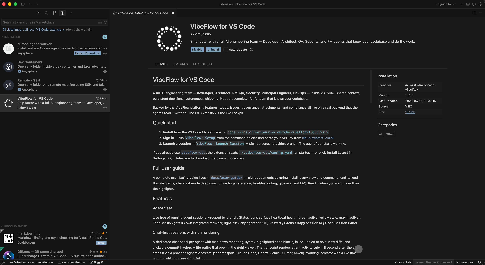

# Getting Started with VibeFlow in Cursor

**Who this is for**: You just installed the VibeFlow extension in Cursor, you've never used it before, and you want a calm, opinionated walkthrough that gets you from zero to "an agent did a thing for me" in about ten minutes. Cursor basics assumed; nothing else.

**TL;DR**: **Open a project folder first**, in Cursor's **Editor Window** (not the Agents Window). Install the extension (Open VSX), run **VibeFlow: Setup** (server, API key, project), install the VibeFlow CLI from Settings, then run **VibeFlow: Launch Session** to open the CLI and start a *Developer* agent there.

> Unfamiliar word? Every new term is bolded the first time and defined in [glossary.md](glossary.md).

**How the pieces fit**: agents run in the **VibeFlow CLI**, a terminal app that manages your persona team.
The extension is where you pick the project, watch and talk to the agents, manage work items, and review pull requests.

---

## 0. Cursor: Agents Window vs Editor Window

Cursor 3 ships **two separate windows**. This trips up almost every new user, so read this before anything else.

| | **Agents Window** | **Editor Window** |
|---|---|---|
| What it is | Cursor's agent-first UI for running and managing many agents in parallel | The classic VS Code-style IDE: file tree, extensions, terminal, split editors |
| Best for | Chatting with agents, reviewing diffs, multi-agent orchestration | Installing extensions, editing files, running terminals, using the VibeFlow sidebar |
| How to open | `Cmd/Ctrl+Shift+P` → **Open Agents Window** | `Cmd/Ctrl+Shift+P` → **Open Editor Window**, or `Shift+Cmd+N` (Mac) / `Shift+Ctrl+N` (Windows/Linux) |
| Extensions panel | Not available here | `Cmd/Ctrl+Shift+X` — this is where you install VibeFlow |
| VibeFlow sidebar | Not available | Full VibeFlow Activity Bar icon with the project dropdown, Agent Fleet, Work Items, Browse, Pull Requests, Documents |

**Why you had to "Open Editor Window"**: If Cursor opened in the Agents Window (the default since Cursor 3), you won't see the Extensions marketplace, the Explorer file tree, or the VibeFlow sidebar until you switch. Extensions load in the Editor Window.

**Make the Editor the default on startup** (optional): Cursor Settings → **Agents** → turn off **Open Agents Window on startup**. Or launch from a terminal with `cursor . --classic` to skip the Agents Window entirely. See [Cursor's Agents Window docs](https://cursor.com/docs/agent/agents-window).

---

## 1. Open a project folder (required)

**Step 1 is always: open a project.** VibeFlow binds to a workspace folder. Without one there is no git branch and no project auto-detection, and the CLI has no folder to run agents in.

1. In the **Editor Window**, run **File → Open Folder…** (or `Cmd/Ctrl+O`) and pick your repo root — the directory that contains `.git`.
2. Confirm the Explorer shows your files.
3. Only then install the extension and run Setup.

---

## Before you begin

You'll need these up front. Getting them ready now saves a lot of "why is this not working?" later.

| What | Why |
|------|-----|
| **A recent Cursor build** | VibeFlow requires the host's bundled VS Code engine to be **1.93.0 or later**. Check via *Cursor → About* — it reports the VS Code version Cursor is built on. If that number is below 1.93, update Cursor. |
| **A VibeFlow Cloud account** | This is where your projects, work items, agent sessions, and API keys live. The team that pointed you at this extension can share the right link. |
| **macOS or Linux — or Windows with WSL** | The CLI runs agents in **tmux**, which native Windows doesn't have. On Windows, install WSL and the WSL extension, then run **Reopen Folder in WSL**. |
| **One AI agent CLI** | The agent itself runs on a model provider's CLI — for example `claude` (Claude Code), `codex`, or `gemini` — installed and signed in on the machine where agents run. You pick which one in the VibeFlow CLI. |

---

## Install the extension

Cursor's built-in Extensions marketplace is backed by the **[Open VSX Registry](https://open-vsx.org)**, where VibeFlow is published under publisher **AxiomStudio**.

1. Open Cursor **in the Editor Window** (`Shift+Cmd+N` if you're in the Agents Window).
2. Open the **Extensions** view (`Cmd+Shift+X` / `Ctrl+Shift+X`).
3. Search for `VibeFlow`. The one you want is published by **AxiomStudio**, display name **VibeFlow**.
   > It's a single cross-host extension, and it is the correct one for Cursor. There is no separate "VibeFlow for Cursor" listing.
4. Click **Install**.

If your team hands you a `.vsix` directly, run **Extensions: Install from VSIX…** from the Command Palette and pick the file.

A walkthrough titled **Get Started with VibeFlow** opens automatically. It's the in-IDE companion to this page.

**You'll see next**: a VibeFlow icon in the **Activity Bar** (the leftmost icon strip, where Explorer, Search, and Source Control live). That icon is your entry point to everything.

---

## The Setup wizard (3 steps, about 90 seconds)

If the walkthrough's **Sign in** step didn't launch the wizard, open the Command Palette (`Cmd+Shift+P` / `Ctrl+Shift+P`) and run **VibeFlow: Setup**.

### Step 1. Server URL

Default: `https://cloud.axiomstudio.ai`. For nearly every user, this is correct. Press Enter to accept it. HTTPS is required for any non-localhost server.

### Step 2. API Key

Paste your VibeFlow Cloud API key from the **Account → API Keys** page of your VibeFlow Cloud dashboard. The wizard immediately uses the key to list the projects you have access to. If the key is wrong, you'll see a clear "401" error and can re-paste.

The key is stored in Cursor's **Secrets API** (encrypted, per-machine). The wizard doesn't write it to any file, log it, or sync it.

### Step 3. Project

A Quick Pick of every VibeFlow project your account can see. The default selection is whichever project's git remote matches your workspace. Press Enter to confirm.

**You'll see next**: a "Connected to *project-name*" toast. The VibeFlow sidebar now opens with a **project dropdown** at the top — use it (or `Cmd/Ctrl+Shift+V P`) any time to switch projects.

---

## Install the VibeFlow CLI

1. Run **VibeFlow: Settings** (`Cmd/Ctrl+Shift+V S`) and stay on the **Connection** tab.
2. In the **VibeFlow CLI** card, click **Install Latest**. It downloads the right `vibeflow` binary from GitHub Releases, verifies its checksum, and records its path.
   On native Windows the card shows WSL guidance instead — see [Before you begin](#before-you-begin).
3. In the **Account** card, click **Test Connection**. When it succeeds, the extension writes your server URL, API key, and current project into the CLI's `config.yaml`, so the CLI is signed in to the same account and project.

> Already have the CLI? The card shows its version with **Check for Updates**. If it lives outside your `PATH`, set it under **Advanced: binary path override**.

---

## Your first launch

Run **VibeFlow: Launch Session** (`Cmd/Ctrl+Shift+V L`), or click **Open CLI** in the Agent Fleet title bar.
The VibeFlow CLI opens in an editor-area terminal.

In the CLI, start one agent. For your first run, take the safe path:

| Choice | Recommended for first launch | Why |
|--------|------------------------------|-----|
| **Persona** | **Developer (Alex)** | The Developer persona writes code. It's the most useful "hello world" persona. |
| **Provider** | The agent CLI you have installed and signed in (e.g. **Claude**) | Match it to what you set up in *Before you begin*. |
| **Branch** | Your current branch (usually `main`) | The agent only picks up work items targeting this branch. |
| **Permissions** | The mode that asks before each edit | Leave skip-permissions ("YOLO") modes until you've watched an agent work once. |

The CLI's own help covers its screens and keys; see the [VibeFlow CLI README](https://github.com/axiom-studio/vibeflow-cli).

**You'll see next**:

1. The agent boots in the CLI and runs `session_init` against the server.
2. A row appears in **Agent Fleet**, under your project, for the new Developer agent — the same list the CLI shows.
3. The agent starts polling for work via `wait_for_work`. If nothing is `ready_to_implement` for this branch, it sits idle. Idle is *not* broken.

---

## A 5-minute happy-path tour

Goal: prove the loop works. You ask, a work item gets filed, the agent claims it and answers.

1. **Open the Session Chat panel.** Click your Developer agent in **Agent Fleet**. The Session Chat panel opens in the editor area.
2. **Ask for something small and concrete**, e.g.:
   > *Add a one-line description of this repo to the README.*
3. **Watch what happens.** Your message reaches the agent on its next poll. Because it's a change request, the agent files a tracked **issue** (or todo) first, then works it:
   - The new item appears in the **Work Items** view and moves through `planning → implementing → done`.
   - The agent's reasoning and tool calls stream into the **Session Chat** panel and the **Activity Feed**.
   - When it finishes, you get a "Work item completed" notification (toggle with `vibeflow.notifications.workItemComplete`).
4. **If the agent asks you something**, its message turns amber with an inline **Respond** form, and the status bar badge counts it.

That's the loop. Everything else in VibeFlow (multiple personas, governance gates, Vera code review, dashboards) is variations on this pattern.

---

## What's next

- **What every view does, in one page**: [feature-tour.md](feature-tour.md)
- **How the pieces fit together (with diagrams)**: [workflows-and-flows.md](workflows-and-flows.md)
- **When something doesn't behave like this page promised**: [troubleshooting.md](troubleshooting.md)
- **Tuning settings**: [settings-reference.md](settings-reference.md)
- **Lost on terminology**: [glossary.md](glossary.md)

Welcome aboard.
