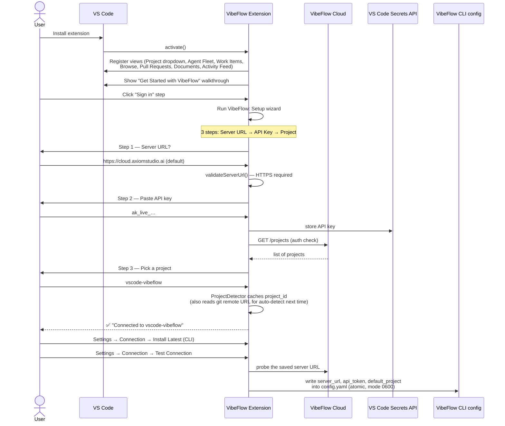
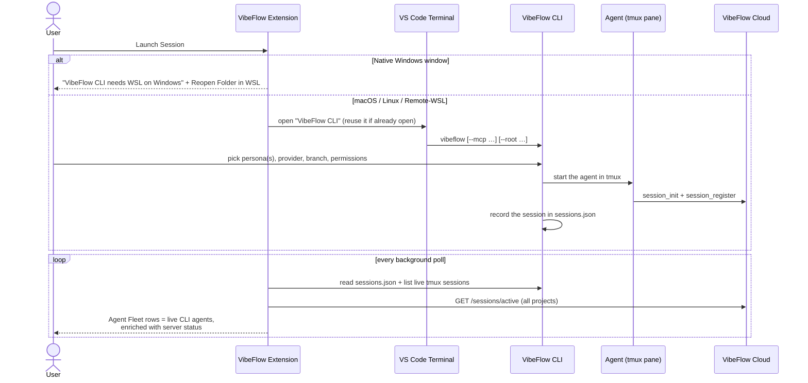
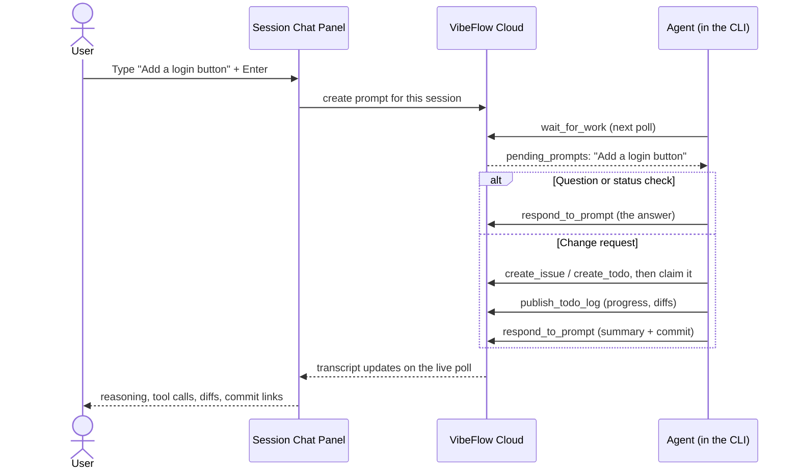
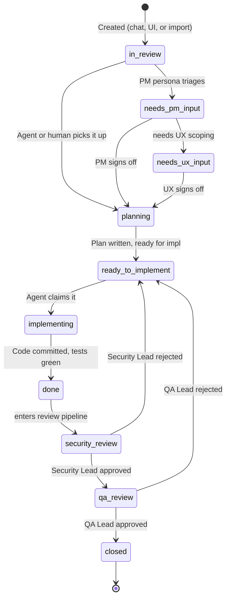
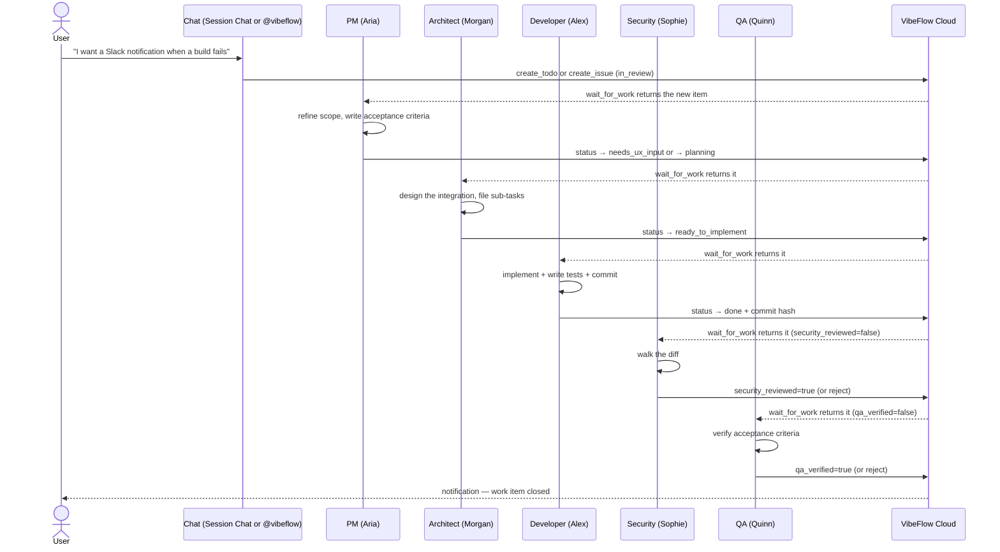
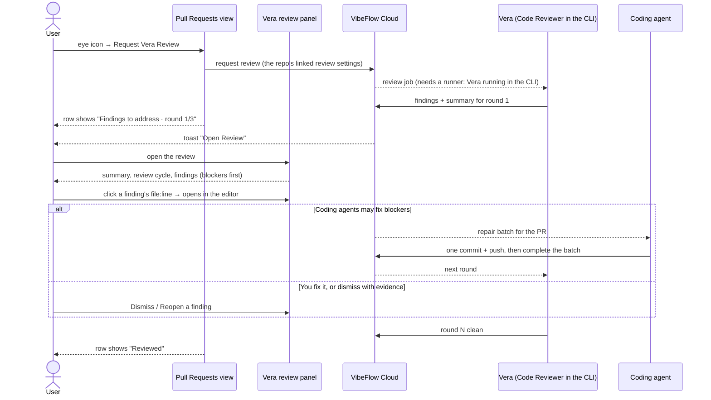

# Workflows and Flow Diagrams

**Who this is for**: Anyone who's installed the extension and wants to understand *how the pieces fit together*. What happens in what order, what calls what, what state moves where. This is the doc for "but **why** is it asking me that?"

**TL;DR**: Seven end-to-end flows that cover most VibeFlow usage. Sequence and state diagrams in Mermaid (GitHub and VS Code render them natively).
Agents run in the VibeFlow CLI; the extension manages the project, shows the agents, and reviews their work.

> See [glossary.md](glossary.md) for any unfamiliar term.

---

## 1. New-user onboarding (first 5 minutes)

You install the extension. VS Code reloads. Here's what happens next, in order:

**What you see**: walkthrough, then "Sign in" link, then three Quick Picks, then a "Connected" toast; then the CLI install and a "Reachable" result in Settings. A few minutes total.

**What can go wrong**: an invalid API key returns 401 from the server; the wizard surfaces the error and lets you re-paste. A non-HTTPS server URL is rejected by `validateServerUrl`. See [troubleshooting.md](troubleshooting.md) for symptoms and fixes.

---

## 2. Launch agents (the most common action)

Agents launch only through the VibeFlow CLI.
**VibeFlow: Launch Session** (`Cmd/Ctrl+Shift+V L`), **Open CLI** in the Agent Fleet title bar, and the empty-fleet row all open it:

**What you see**: the CLI opens in an editor-area terminal; once an agent starts, it appears in Agent Fleet under its project — the same list the CLI shows.

**Why the CLI**: one launcher for every editor and the terminal, with sessions that survive closing VS Code (they live in tmux).
Provider, branch, worktree, and permission choices all live in the CLI.

---

## 3. Talking to an agent

Click an agent in Agent Fleet to open its **Session Chat** panel.

Agents work from tracked work items, so a change you ask for in chat becomes an issue or todo first — you'll see it in **Work Items** and can follow its execution log.
When an agent needs *your* decision, its message turns amber with an inline **Respond** form and the status bar badge counts it.

> **Chat-first sessions**: sessions started in the extension's older chat-first mode run hidden and treat the chat as their only input, with a fresh agent process per message.
> New agents launch from the CLI instead; see [chat-first-mode.md](chat-first-mode.md) if you still have chat-first sessions.

---

## 4. Work item lifecycle: from idea to closed

Every feature, todo, and issue moves through the same status machine. The shape:

**Where you (the human) typically step in**:
- **`in_review`**: you review what an agent or another user filed. Decide whether to promote.
- **`done` → `security_review`**: if you're acting as the Security Lead, you walk the diff and approve or reject.
- **`security_review` → `qa_review`**: if you're acting as QA Lead, you verify the AC.
- **Anywhere**: you can comment, change priority, change branch, change parent feature.

**Where agents step in**:
- `in_review → planning` (architect agents claim items in `ready_to_implement` or `architecture_review_complete`)
- `planning → ready_to_implement` (after writing a plan)
- `ready_to_implement → implementing → done` (developer agents)
- `done → security_review → qa_review` (security/QA agents auto-poll for items needing their gate)

**The review gates exist on purpose**: silent regressions caught in production are the worst kind.

---

## 5. Multi-persona handoff

A real workflow often touches multiple personas. Example: you ask for a new feature in chat. Here's what happens:

**Each persona is its own session** (one agent per persona, launched from the CLI, polling independently). They never talk to each other directly. Coordination happens through the work item's status field and execution log on the server.

**You can collapse this**: not every team needs all 9 personas active. A minimal team is *Architect + Developer + QA*: three sessions, the rest implicit (you act as the PM and Security yourself).

---

## 6. Vera code review on a pull request

When a developer agent (or you) opens a PR on a repository linked for Vera reviews, the extension shows the review and lets you drive it:

**What you see**: Vera's state on each PR row, a toast when a review finishes, and a review panel whose controls (Re-run, Pause, Continue, Retry PR update, Dismiss/Reopen) are enabled exactly when the server allows them.
Project owners and org admins set each repository's review policy (trigger, rounds, skip drafts, whether coding agents may fix blockers) in Settings → **Project**.

---

## 7. Worktrees (multi-branch parallelism)

When you want a Developer agent working on `feature/foo` while you keep working on `main`, run it in a **git worktree**: a second checkout of the repo on another branch, sharing the same `.git`.

The CLI creates and runs agents in worktrees; the extension shows them:

- **Agent Fleet ▸ Worktrees** lists every worktree with its branch, path, current marker, and dirty status.
- Right-click a worktree to **Open in New Window** (browse or edit it in a separate VS Code window) or **Delete** it (`git worktree remove`, with a confirmation that warns about uncommitted changes).
- Agents running in a worktree show their branch in Agent Fleet like any other agent.

**Why this matters**: you can have 3 Developer agents running in parallel on 3 different branches, each in its own worktree, none of them stepping on each other or on your main checkout.

**Cleanup gotcha**: deleting a worktree with uncommitted work loses that work. Check the dirty marker first.

---

## Putting it all together: a realistic day

```mermaid
gantt
    title A morning with VibeFlow
    dateFormat HH:mm
    axisFormat %H:%M

    section You
    Open VS Code, walk Activity Feed :a1, 09:00, 5m
    Review overnight QA results       :a2, 09:05, 10m
    Ask for a feature in Session Chat :a3, 09:15, 5m
    Answer the PM's clarification     :a5, 09:30, 5m
    Read Vera's review in the panel   :a6, 11:10, 10m

    section PM Agent (Aria)
    Files and refines the item        :p1, 09:20, 15m
    Pings you for clarification       :p2, 09:35, 1m

    section Architect (Morgan)
    Plans architecture                :ar1, 09:45, 25m
    Files implementation todos        :ar2, 10:10, 5m

    section Developer (Alex)
    Implements first todo             :d1, 10:20, 35m
    Commits, pushes, opens PR         :d2, 10:55, 5m

    section Vera (Code Reviewer)
    Reviews the PR                    :v1, 11:00, 10m
```

You spend ~35 minutes of human attention; the agents do the rest in parallel. The Activity Feed and the Pull Requests view show every transition above.

---

## What this doc deliberately doesn't cover

- **The CLI's own screens and keys**: see the [VibeFlow CLI README](https://github.com/axiom-studio/vibeflow-cli).
- **Compliance findings** workflow: see the **Compliance** panel.
- **Document comments + persona handoff** workflow: the comments feature is its own subsystem; see the Documents view.

---

*If a flow you care about isn't covered, open an issue at the VibeFlow repo with the question.*
